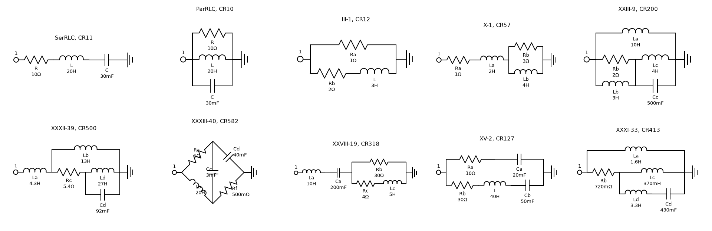

# crcat: CRCat in Python

Python port of [CRCat](https://github.com/Sonnet-Software/CRCat) by James C. Rautio (Sonnet
Software). CRCat finds small lumped RLC models for measured or simulated data:

- a catalog of every RLC network with up to five elements (623 networks), with closed-form
  synthesis equations from rational-polynomial coefficients to element values and transforms
  between equivalent networks,
- a direct (non-iterative) least-squares fit of a rational polynomial, in high-precision
  arithmetic,
- a search that fits every network of the catalog to the data and ranks them.

The theory is in J. C. Rautio, "Direct Least-Squares Rational-Polynomial Lumped-Circuit Model
Extraction and Group Theory," IEEE Journal of Microwaves, 2025,
doi:[10.1109/JMW.2025.3598986](https://doi.org/10.1109/JMW.2025.3598986).

This is the `netlist-tool` branch: the port of CRCat (branch `main`) plus a tool on top of
it that turns S-parameter data into a SPICE or Spectre netlist, at the command line or in a
small window. Everything under [From S-parameters to a netlist](#from-s-parameters-to-a-netlist)
is on this branch only.

No MATLAB is needed: the catalog was converted from CRCat's `.mat` files to JSON (see
[The catalog](#the-catalog)), and the numerics use mpmath instead of MATLAB's variable
precision arithmetic.

## Installation

```
pip install -e .            # numpy, mpmath, scikit-rf
pip install -e ".[gui]"     # also PySide6 and matplotlib: window and plots
pip install -e ".[fast]"    # also gmpy2: the searches run about 1.4 times faster
```

## From S-parameters to a netlist

```
crcat-netlist mim_170fF.s2p --fmax 100
crcat-gui                       # the same in a window
```

A reciprocal n-port is exactly a set of branches: one from each port to ground and one
between each pair of ports (for a 2-port, the pi network). Each branch is a one-port, so the
catalog can model it with up to five R, L, C, and the netlist is these networks wired
together.

For each branch, a candidate network is judged in three ways:

- **S-parameter error.** The candidate replaces the branch in the data, and the RMS
  difference of all S-parameters is its error (limit `--target-db`, default -40 dB).
- **Reactance and loss at the ports.** What the candidate does to the input admittance Yii
  of each port, all other ports shorted: the reactance error is the RMS of Im dYii / |Yii|
  (limit `--reactance-percent`, default 20 %), the loss error the RMS of Re dYii / Re Yii
  (limit `--loss-percent`, default 30 %). The port where the error is largest counts.

The S-parameters alone miss two things. A part that is nearly a through or an open in 50 ohm
hides its errors: for a 74 pH inductor, a model without any series resistance at low
frequency passed the -40 dB limit. And the loss of a high-Q part is a small part of its
admittance: for a 500 pH inductor, a model whose series resistance stayed at 1.9 ohm while
the data rose from 1.8 to 5.6 ohm was within 2.5 % in |Y|. The loss error compares a
branch's loss with the loss of the whole port, so the series resistance of an inductor counts
fully, while the loss of a small parasitic branch hardly counts. Port losses below |Yii| / 100
count as none.

Element values come from the closed-form synthesis of a rational fit, which does not aim at
the loss. The best few networks of each element count are therefore refined: a bounded
least-squares fit of their element values on all three measures together, signs kept, each
value within a factor of 1000 of its start ("refined" in the result; `--no-refine` to skip).
A refined value that runs to that bound is not determined by the data, and that refinement
is dropped.

The default choice is the network with the fewest elements, all positive, that is within
all limits. "Open" counts as a candidate, so weak branches disappear. If nothing is within
the limits, candidates up to 1.25 times the best one are accepted and a warning is printed.

The tool starts with the pi form and tries two other forms when that fails, see
[Tee form](#tee-form) and [Coupled coils](#coupled-coils).

Example, a 170 fF MIM capacitor from a Palace simulation (1-300 GHz data, fitted to
100 GHz):

```
p1 - gnd   CR3 C refined         -41.4 dB  X  0.431 %  loss   1.74 %  C=8.987fF
p2 - gnd   CR3 C refined         -41.6 dB  X  0.427 %  loss   1.74 %  C=0.688fF
p1 - p2    CR11 SerRLC refined   -57.4 dB  X   1.85 %  loss   6.45 %  R=1.04Ohm L=7.096pH C=170.9fF
model (pi form): 5 elements, S-parameter error -49.9 dB rms, -41.7 dB max
```

```
.SUBCKT mim_170fF_model p1 p2
C_p1 p1 0 8.98727e-15
C_p2 p2 0 6.88033e-16
R_p1p2 p1 p1p2_n2 1.04016
L_p1p2 p1p2_n2 p1p2_n3 7.09555e-12
C_p1p2 p1p2_n3 p2 1.70939e-13
.ENDS mim_170fF_model
```

Five elements per branch are a real limit for inductors: the series resistance of the 500 pH
inductor above (snp2le example `ind_500pH_ihp-sg13cmos5l.s2p`, fitted to 50 GHz) becomes a
constant 2.9 ohm with the default choice (7 elements, -41.9 dB), and rises from 2.8 to
4.9 ohm with `--pick best` (14 elements, -48.7 dB); neither has the 1.8 ohm at low
frequency. The L, R, Q plot shows this.

Written next to the input file: the netlist (`_crcat.sp`; with `--format spectre` or `both`
also `_crcat.scs`), the S-parameters of the model (`_crcat.sNp`), the result as JSON, the
plots (see below) and the schematics of all branches (`_crcat_schematic.png`).


In the window, the Network column lists the other networks tried for each branch; choosing
one updates netlist, errors, schematic and plot at once. The table shows the S-parameter,
reactance and loss errors of each branch. The panel under the table shows
the schematic of the selected row with its element values; coupled coils are drawn as a
pair with their coupling factor:


### Plots

| View | Shows | File |
|---|---|---|
| S-parameters | magnitude and phase, data (thin line with circles) and model (solid line) | `_crcat.png` |
| Error | \|S model - S data\| of each S-parameter against frequency, with the limit | `_crcat_error.png` |
| L (or C), R, Q | 2-ports: series L or C and series R from -1/Y21, Q from 1/Y11 | `_crcat_lrq.png` |

The plots show the fit band; "All data" in the window (`--plot-all-data`) shows every
frequency of the data with the fit band shaded. In the window, a click or drag in the plot
sets a marker; the readout under the plot lists data and model of every curve there (in
the S-parameter view also their difference), and the left / right arrow keys move the
marker by one frequency point. The marker stays at its frequency when the view changes. S-parameters that coincide are drawn once
("S11 = S22"). With more than 8 different S-parameters, the 8 with the largest error are
drawn. The Error view does not depend on the axis scale or on how small an S-parameter is;
the L, R, Q view shows what an inductor or capacitor is judged by.

### Tee form

A device with a common path to ground is a tee by nature: two series legs to a center node
and one leg from there to ground. Forced into a pi, its loss can land in a branch with a
negative real part, which no positive resistor can give. For a 2-port, the tool therefore
also tries the tee form when a pi branch misses its limit, and keeps the form with the
lower error. A shorted series leg is a candidate there, like an open branch in the pi form.

Example: the same MIM capacitor over the full 1-300 GHz. In the pi form the port-2 branch of
the data has a negative real part in 96 % of the band (model error -19.3 dB). The tee form:

```
p1 - c     CR11 SerRLC refined   -60.1 dB  X   1.46 %  loss   6.32 %  R=605.9mOhm L=3.282pH C=914.9fF
p2 - c     CR11 SerRLC refined   -56.5 dB  X   2.21 %  loss   9.72 %  R=637.2mOhm L=3.022pH C=212.9fF
c - gnd    CR3 C refined         -57.5 dB  X 0.0308 %  loss 0.0236 %  C=9.556fF
model (tee form): 7 elements, S-parameter error -51.5 dB rms, -44.0 dB max
```

### Coupled coils

Magnetic coupling between two branches shows in the pi form as a negative inductance, and
often a negative resistance, in the branch between them. When such a branch misses its limit
(or got a negative element), the tool tries to replace it and its two neighbours by two
coils with a coupling factor (SPICE `K`, Spectre `mutual_inductor`), plus a common resistor
if that helps. What the coils do not explain of the branch between the two ports stays a
branch of its own. The replacement is kept if it lowers the error. A quick test comes
first: the coils of the data with one coupling factor must show a coupling of at least
0.05 and beat the three branches as they are; otherwise no search is made.

Example: a center-tapped inductor (3-port, center tap at port 3), fitted to 30 GHz. As a pi
of positive elements over its full band the error was -12.5 dB. With coupled coils:

```
p1 - gnd   CR3 C refined         -65.9 dB  X 0.00453 %  loss  0.536 %  C=6.014fF
p2 - gnd   CR3 C refined         -65.2 dB  X 0.00528 %  loss  0.536 %  C=6.354fF
p3 - gnd   open                  -40.7 dB  X  0.624 %  loss  0.287 %  no elements
p1 - p2    open                  -44.2 dB  X   6.09 %  loss   25.6 %  no elements
p1, p2 - p3 coupled coils: CR7 SerRL + CR7 SerRL   -44.2 dB
           R=1.272Ohm L=164.4pH | R=1.596Ohm L=166.1pH | k=-0.3895
model (pi form): 7 elements, S-parameter error -38.9 dB rms, -31.5 dB max
```

```
R_k12a p1 k12a_n2 1.27215
L_k12a k12a_n2 p3 1.64443e-10
R_k12b p2 k12b_n2 1.59621
L_k12b k12b_n2 p3 1.6611e-10
K_k12 L_k12a L_k12b -0.389523
```

The coupling factor is one number for the whole band. Towards the resonance the apparent
mutual inductance of this inductor grows (from -59 pH to -109 pH at 60 GHz), so over the full
0.01-60 GHz the model reaches -31.0 dB only.

Each coil must have an inductor that carries the whole coil current, so coils with a
capacitor across their terminals (a transformer whose only other branches go to ground) are
not replaced.

### Sequential fitting

By default every branch is fitted to its own data: the branch to ground at port i to the
sum of column i of Y. With `--sequential` (a suggestion of J. Rautio) the branches between
ports are fitted first, and the target of the branch to ground becomes Yii minus the
*models* of those branches. The branch to ground then makes up for what the series models
missed, and Yii of the model follows the data more closely.

It is off by default, because what a series model missed is often not the admittance of
any R, L, C network. Compared on the example files (same settings otherwise):

| Data | default | sequential |
|---|---|---|
| 500 pH inductor (snp2le example), to 50 GHz | -41.9 dB, median Q error 18 % | -41.4 dB, 16 % |
| 500 pH inductor (lumpedmodel example) | -39.8 dB, 27 % | -40.1 dB, 25 % |
| 170 fF MIM, to 100 GHz | -49.7 dB, no warning | -42.7 dB, 1 warning |
| center-tapped inductor, to 30 GHz | -38.9 dB, no warning | -31.6 dB, 3 warnings |

So it gives a small gain in Q for the two inductors and a loss for the capacitor and the
center-tapped inductor. Worth a try for a 2-port inductor; the L, R, Q plot shows the result.

### Options

Main options (`crcat-netlist --help` lists all):

| Option | Meaning |
|---|---|
| `--fmin`, `--fmax` (GHz) | fit band; the plot still shows all data |
| `--require positive` | all element values positive (default) |
| `--require positive-r` | resistors positive, L and C of either sign. Still passive, since only resistors dissipate |
| `--require passive`, `any` | any signs if the branch stays passive; no restriction |
| `--pick simplest` | fewest elements within the error limit (default) |
| `--pick best` | lowest error |
| `--target-db` | S-parameter error limit per branch (default -40 dB) |
| `--reactance-percent` | port reactance error limit (default 20 %); 0 = off |
| `--loss-percent` | port loss error limit (default 30 %); 0 = off |
| `--no-refine` | keep the element values of the closed-form synthesis |
| `--max-elements` | most elements per branch (1..5) |
| `--form auto`, `pi`, `tee` | auto (default): pi, and the tee form for a 2-port if a pi branch misses the limit |
| `--sequential` | pi form: fit the branches to ground to the port admittance minus the models, not the data, of the branches between ports |
| `--no-coupling` | never use coupled coils |
| `--delay` (ps) | a line of the reference impedance and this delay at each port: removed from the data before the fit, written as a `T` element (Spectre `tline`) |

Limits:

- **Five elements per branch.** A branch with several resonances in the band needs a
  narrower band.
- **Distributed parts.** A structure that is not small against the wavelength, or a net of
  strongly coupled conductors, is not a pi of small branches: for a 6-port feed structure
  12 of 21 branches of the data had a negative real part even below 40 GHz. `--delay`
  takes a known feed line out; there is no automatic search for it (a search by how
  physical the branches become was not reliable, since a short line is the same as a
  series L and a shunt C, which the lumped elements cover).
- **Tee form for 2-ports only.** A tee has too few branches for a general n-port.
- **One coupling factor per coil pair,** see above; and coupled loss that needs a negative
  resistance stays out unless `--require any`.
- The tool warns when a branch misses its limit and when the data of that branch have a
  negative real part.
- The model is reciprocal; non-reciprocal data are symmetrized, and the difference is
  reported.

In Python, without any GUI or plotting import:

```python
import crcat

model = crcat.extract('dut.s2p', crcat.Options(fmax=100e9))   # or a scikit-rf Network
print(model.summary())
text = crcat.to_spice(model, 'dut')
s = model.s_matrix(freq)              # S-parameters of the model
model.choose(2, 1)                    # another candidate for branch 2
```

`extract` takes `progress(fraction, text)` and `cancel()` callbacks; `crcat.gui` is only a
window on top of this.

## Searching the catalog for one branch

Search the catalog for the best model of the pi-model shunt admittance at port 1:

```
crcat-seed tests/data/XXXII-39.y1p --top 10 --plot fit.png
```

```
Up to the 10 best fits (Id, RMS error; * = passive):
  (500* 3.13e-13) (624* 3.13e-13) (413* 3.13e-13) (239* 3.13e-13) (202* 0.00995) ...
Best passive models:
  CR500 XXXII-39, rms 3.13e-13: La=500pH Lb=400pH Rc=10Ohm Ld=200pH Cd=3pF
  CR413 XXXI-33, rms 3.13e-13: La=900pH Rb=50.63Ohm Lc=2.137nH Ld=2.375nH Cd=133fF
  ...
```

The data are the Y-parameters of network XXXII-39 (CR500) with known element values
(La 0.5 nH, Lb 0.4 nH, Rc 10 ohm, Ld 0.2 nH, Cd 3 pF), computed by a circuit simulator:
the file is CRCat's test data, made with Sonnet's netlist (not EM) simulation. So the
search should find that network and its equivalents with exactly these values, and it does.
"Passive" means Re Y >= 0 at all frequencies, which still allows negative elements; the report therefore also lists the
best models whose element values are all real and positive. For the series branch of a
170 fF MIM capacitor simulated with Palace (1-300 GHz, `--fit y21`), for example, that list
starts with 5-element models (C plus a frequency-dependent loss) and contains the plain
series RLC (CR11: R 1.36 ohm, L 6.16 pH, C 180.7 fF). `--fit` selects the data:
`y11` (pi-model admittance port 1 to ground, default), `y21` (pi-model admittance between
ports 1 and 2), `z11` / `z21` (tee model), `Y11`, `Z11`, `S11` (the parameter itself). A
leading number fits only the first frequencies, e.g. `--fit 200y11`. `crcat-seed --help`
lists all options.

In Python:

```python
import numpy as np
import crcat

cat = crcat.load()                         # 623 base + 8 custom networks
result = crcat.seed('measured.s2p', cat, fit='y21')
print(result.report())
best = result.best(1, passive=True)[0].component

c = crcat.Component('XXXII-39', cat)       # catalog test values (GHz, nH, nF, ohm)
f = np.linspace(1, 20, 40)
y = c.eval(f)[0]                           # admittance (one row per solution)
c.fit(y, f)                                # fit: RMS error per solution, values from the fit
c.transform('XXXI-33')                     # an equivalent network
c.is_passive()
cat.relations(500)                         # [(239, 'Equiv'), (413, 'Equiv'), (500, 'Self')]

from crcat import draw
draw.save(draw.figure(best), 'best.png')   # schematic with element values
draw.figure_array([e.component for e in result.best(10)])   # up to ten in a grid

r = crcat.crfit(y, f, [1] * 6, [1] * 6)    # rational fit with 6 + 6 terms
r, digits = crcat.fit_auto(y, f)           # order and precision chosen automatically
s_new = crcat.interpolate(network, f_new)  # scikit-rf Network at new frequencies (Hz)
```

Units are any consistent set (GHz, nH, nF, ohm or Hz, H, F, ohm). `seed` works in Hz, so
its element values are in H, F and ohm; `Component.format()` assumes these units.

## Schematics

`crcat.draw` draws every network of the base catalog with CRCat's own layouts (the
coordinate tables of `CRCat.Draw`, in `src/crcat/data/draw_layout.json`), from the port
terminal on the left to ground on the right:



Element values are printed for a `Component`, names only for a network. Networks of the
custom catalog whose name does not start with a known topology have no layout, as in CRCat.

## What is ported

| CRCat (MATLAB) | crcat |
|---|---|
| `CRFit` | `crcat.fit.crfit` |
| `CREval` | `crcat.fit.evaluate` |
| `CRFitAuto`, `CRInterp` | `crcat.fitauto.fit_auto`, `interpolate` |
| `@CRCat` (catalog, `Relationship`, `NetworkRelations`, `FindOrder`) | `crcat.catalog` |
| `CRComp` (`Eval`, `Fit`, `Transform`, `IsGain`, `ElementValues`) | `crcat.component.Component` |
| `CRSeed`, `CRSeedAddNoise` | `crcat.seed.seed`, `crcat-seed` |
| `CRSprout` | `crcat.sprout.sprout` |
| `CRCat.Draw`, `DrawArray`, `DrawRLC` | `crcat.draw` (`figure`, `figure_array`, `draw_network`) |
| `SnP` (`Get`, `Pull`, `AddNoise`) | scikit-rf, `crcat.data.pull`, `seed(noise_floor_db=...)` |
| (not in CRCat, this branch) | `crcat.model.extract`, `crcat.netlist`, `crcat.schematic`, `crcat-netlist`, `crcat-gui` |

Not ported: generating the catalog and its equations (`FillCat_*`, MATLAB `solve`),
`CRFitClean`, and the interactive prompts of `CRSeed`. Networks can therefore not be added to the custom catalog in Python yet.

### Differences from CRCat

- **More networks fit.** The normal equations of the rational fit span many decades when
  frequencies are in Hz. CRCat's solver declares some of them singular (code -3; the README
  example lists CR485). This port scales the matrix first, which does not change the
  solution, so these networks fit too. Their errors come from evaluating the synthesized
  network and agree with a nodal analysis. The search can therefore list networks that
  CRCat's list does not have (CR202 in the example above).
- **Passivity is checked for the best solution.** CRCat reports the smallest error of all
  solutions but checks passivity of solution 1. The check here decides by the sign of the
  real part between its zeros, so a real part that only touches zero counts as passive. A
  model whose real part is zero in exact arithmetic (CR505 in the example) can come out
  either way.
- **`root(p, z, k)`**: 33 networks have synthesis equations with the k-th root of a
  polynomial. MATLAB's numbering of the roots is not documented, so all roots are tried; a
  fit returns all solutions, sorted by error.
- **`Y12`-type data selection** returns the Y-parameter itself. CRCat's code (commit
  `c805a25`) returns the negative; its author confirmed that this is an error there (the
  minus sign belongs only to the lower-case `y12`, the pi-model admittance between two
  ports).
- **The default catalog** is base + custom without the transforms between base and custom
  networks (CRCat recomputes those).
- The 35 base networks whose synthesis equations are all zero are treated as having none.
- Added on this branch: the filter for models with positive real element values
  (`best(physical=True)`).

## The catalog

`src/crcat/data/catalog_base.json` holds the 623 networks of CRCat's base catalog,
`catalog_custom.json` the 8 example networks of its custom catalog. For each network:

| Field | Meaning |
|---|---|
| `id`, `name` | CRCat Id (1-based index, "CR500") and name ("XXXII-39": topology XXXII, 39th way to fill it) |
| `symVn`, `nodes` | element names and netlist: element k connects `nodes[2k]` and `nodes[2k+1]`; port is node 1, ground node 0 |
| `symV` | elements that have synthesis equations (the others are fixed, given by the user) |
| `A`, `B`, `Acoef`, `Bcoef` | admittance Y(s) = A/B; the coefficient lists are highest power of s first |
| `symC`, `flagSig` | rational-polynomial coefficients used (`a`k: s^k in A, `b`k: s^k in B) and their signature |
| `EL` | synthesis equations: element values `symV` from `symC` (and fixed elements); several rows = several solutions; `null` if none exist |
| `testEL` | test element values for `symVn` |
| `same` | for each network with the same signature: transform equations (element values of the other network from this one's `symVn`) or a status (`NoXfrm`, `Nil`, `Trivial`, `EqnNotFound`) |

Expressions are Python-syntax text that `sympy.sympify` also reads. Non-integers are written
`Rational(p, q)` or `Float('...', 40)`; shared subexpressions are listed under `let` as `t1`,
`t2`, ... and evaluated first. MATLAB's `root(p, z, k)` is written `root([c_n, ..., c_0], k)`
with the coefficients of p. `crcat.symbolic` compiles the text into plain Python functions on
mpmath numbers.

The zeros and poles of CRCat's catalog (`symZeros`, `symPoles`) are not converted; compute them
numerically from `Acoef` and `Bcoef`.

### How it was converted

MATLAB stores symbolic values in `.mat` files in MuPAD's binary serialization. That format
is not documented; `tools/mupad_decode.py` decodes the part of it the catalogs use, and
`tools/convert_mat.py` writes the JSON files:

```
pip install -e ".[dev]"     # adds sympy and mat-io
python tools/convert_mat.py <CRCat checkout>
```

The JSON files were made from CRCat commit `c805a25` (2025-11-22).

### Validation

`tools/validate_catalog.py` checks every network against its own netlist:

| Check | Result |
|---|---|
| A/B (and `Acoef`/`Bcoef`) equal a nodal analysis of the netlist (random values, random complex s) | 631 of 631 networks |
| Synthesis round trip: coefficients of A/B at `testEL` through `EL` give `testEL` back | 499 of 499 networks with equations |
| Transforms: transformed values give the same admittance | 4844 of 4844 (16 more in the custom catalog have fixed elements and are not checked) |

The counts match the paper: 491 base networks with synthesis equations (plus 35 whose
equations are all zero), and 4651 transforms (4836 sets of equations, less 491 to the network
itself, plus 306 marked `EqnNotFound`).

## Tests

```
pip install -e ".[dev]"
python -m pytest            # fast tests (about 45 s, GUI offscreen)
python -m pytest -m slow    # catalog validation, full searches (about 1.5 min)
```

The tests check against CRCat's README example and its MATLAB tests (`CRCompTest.m`,
`CRSproutTest.m`, `CRFitAutoTest.m`); the test data in `tests/data` come from CRCat.

## License

MIT, like the original. CRCat, its catalog data and the test data are Copyright (c) 2025
Sonnet Software Inc. If you use this work, please acknowledge CRCat and cite the paper above,
as its author asks.
