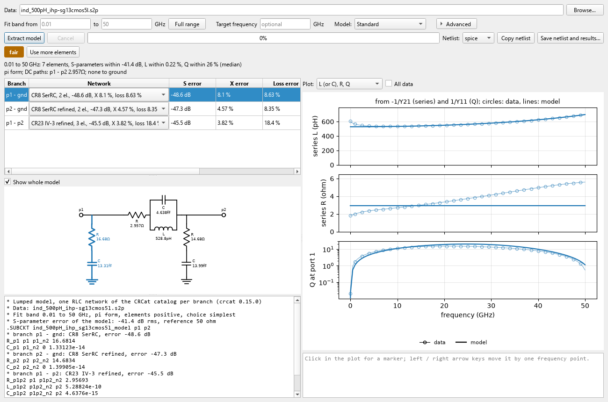
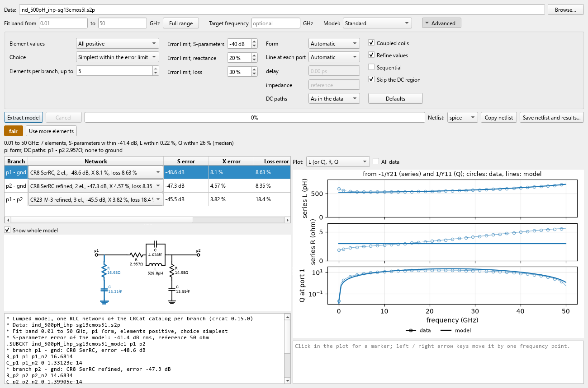
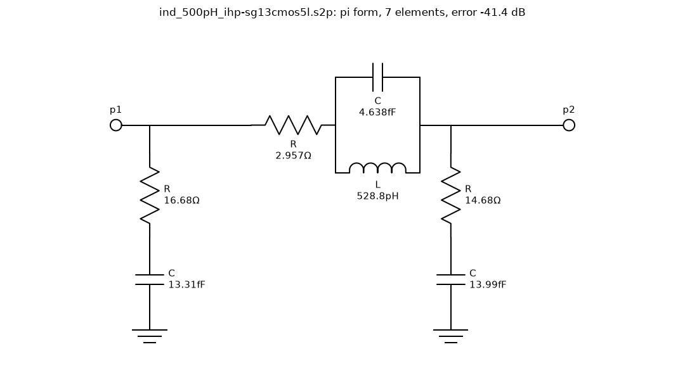
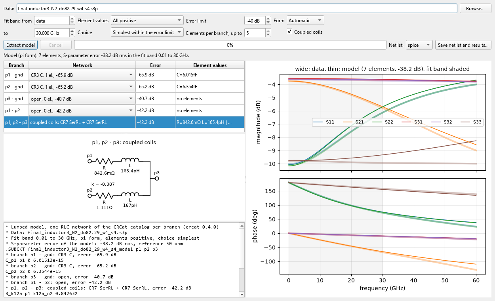
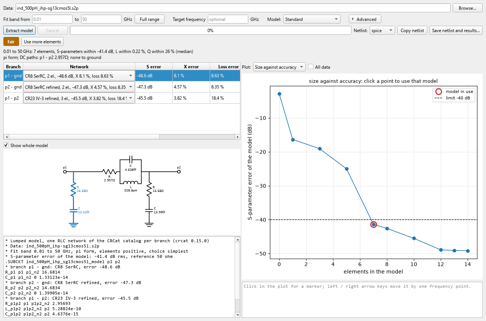
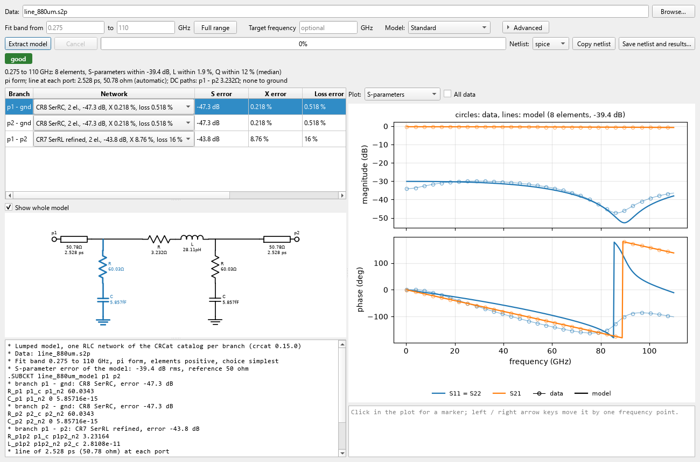

# crcat: CRCat in Python

Python port of [CRCat](https://github.com/Sonnet-Software/CRCat) by James C. Rautio (Sonnet
Software). CRCat finds small lumped RLC models for measured or simulated data:

- a catalog of every RLC network with up to five elements (623 networks), with closed-form
  synthesis equations from rational-polynomial coefficients to element values and transforms
  between equivalent networks,
- a direct (non-iterative) least-squares fit of a rational polynomial, in high-precision
  arithmetic,
- a search that fits every network of the catalog to the data and ranks them.

The theory is in J. C. Rautio, "Direct Least-Squares Rational-Polynomial Lumped-Circuit Model
Extraction and Group Theory," IEEE Journal of Microwaves, 2025,
doi:[10.1109/JMW.2025.3598986](https://doi.org/10.1109/JMW.2025.3598986).

This is the `netlist-tool` branch: the port of CRCat (branch `main`) plus a tool on top of
it that turns S-parameter data into a SPICE or Spectre netlist, at the command line or in a
small window. Everything under [From S-parameters to a netlist](#from-s-parameters-to-a-netlist)
is on this branch only.

No MATLAB is needed: the catalog was converted from CRCat's `.mat` files to JSON (see
[The catalog](#the-catalog)), and the numerics use mpmath instead of MATLAB's variable
precision arithmetic.

Questions of RF designers who want to use an EM-simulated part in SPICE are answered in
the [FAQ](doc/FAQ.md).

## Contents

- [Installation](#installation)
- [From S-parameters to a netlist](#from-s-parameters-to-a-netlist)
  - [Data check, verdict and suggestions](#data-check-verdict-and-suggestions)
  - [Target frequency](#target-frequency)
  - [Size against accuracy](#size-against-accuracy)
  - [Line at the ports for a distributed part](#line-at-the-ports-for-a-distributed-part)
  - [Testbench](#testbench)
  - [DC paths](#dc-paths)
  - [Plots](#plots)
  - [Tee form](#tee-form)
  - [Coupled coils](#coupled-coils)
  - [Sequential fitting](#sequential-fitting)
  - [Options](#options)
- [Searching the catalog for one branch](#searching-the-catalog-for-one-branch)
- [Schematics](#schematics)
- [What is ported](#what-is-ported)
  - [Differences from CRCat](#differences-from-crcat)
- [The catalog](#the-catalog)
  - [How it was converted](#how-it-was-converted)
  - [Validation](#validation)
- [Tests](#tests)
- [License](#license)

## Installation

```
pip install -e .            # numpy, mpmath, scikit-rf
pip install -e ".[gui]"     # also PySide6 and matplotlib: window and plots
pip install -e ".[fast]"    # also gmpy2: the searches run about 1.4 times faster
```

## From S-parameters to a netlist

```
crcat-netlist mim_170fF.s2p --fmax 100
crcat-gui                       # the same in a window
```

A reciprocal n-port is exactly a set of branches: one from each port to ground and one
between each pair of ports (for a 2-port, the pi network). Each branch is a one-port, so the
catalog can model it with up to five R, L, C, and the netlist is these networks wired
together.

For each branch, a candidate network is judged in three ways:

- **S-parameter error.** The candidate replaces the branch in the data, and the RMS
  difference of all S-parameters is its error (limit `--target-db`, default -40 dB).
- **Reactance and loss at the ports.** What the candidate does to the input admittance Yii
  of each port, all other ports shorted: the reactance error is the RMS of Im dYii / |Yii|
  (limit `--reactance-percent`, default 20 %), the loss error the RMS of Re dYii / Re Yii
  (limit `--loss-percent`, default 30 %). The port where the error is largest counts.

The S-parameters alone miss two things. A part that is nearly a through or an open in 50 ohm
hides its errors: for a 74 pH inductor, a model without any series resistance at low
frequency passed the -40 dB limit. And the loss of a high-Q part is a small part of its
admittance: for a 500 pH inductor, a model whose series resistance stayed at 1.9 ohm while
the data rose from 1.8 to 5.6 ohm was within 2.5 % in |Y|. The loss error compares a
branch's loss with the loss of the whole port, so the series resistance of an inductor counts
fully, while the loss of a small parasitic branch hardly counts. Port losses below |Yii| / 100
count as none.

Element values come from the closed-form synthesis of a rational fit, which does not aim at
the loss. The best few networks of each element count are therefore refined: a bounded
least-squares fit of their element values on all three measures together, signs kept, each
value within a factor of 1000 of its start ("refined" in the result; `--no-refine` to skip).
A refined value that runs to that bound is not determined by the data, and that refinement
is dropped.

The default choice is the network with the fewest elements, all positive, that is within
all limits. "Open" counts as a candidate, so weak branches disappear. If nothing is within
the limits, candidates up to 1.25 times the best one are accepted and a warning is printed.

The tool starts with the pi form and tries two other forms when that fails, see
[Tee form](#tee-form) and [Coupled coils](#coupled-coils).

Example, a 170 fF MIM capacitor from a Palace simulation (1-300 GHz data, fitted to
100 GHz):

```
p1 - gnd   CR3 C refined         -41.4 dB  X  0.431 %  loss   1.74 %  C=8.987fF
p2 - gnd   CR3 C refined         -41.6 dB  X  0.427 %  loss   1.74 %  C=0.688fF
p1 - p2    CR11 SerRLC refined   -57.4 dB  X   1.85 %  loss   6.45 %  R=1.04Ohm L=7.096pH C=170.9fF
model (pi form): 5 elements, S-parameter error -49.9 dB rms, -41.7 dB max
```

```
.SUBCKT mim_170fF_model p1 p2
C_p1 p1 0 8.98727e-15
C_p2 p2 0 6.88033e-16
R_p1p2 p1 p1p2_n2 1.04016
L_p1p2 p1p2_n2 p1p2_n3 7.09555e-12
C_p1p2 p1p2_n3 p2 1.70939e-13
.ENDS mim_170fF_model
```

Five elements per branch are a real limit for inductors: the series resistance of the 500 pH
inductor above (snp2le example `ind_500pH_ihp-sg13cmos5l.s2p`, fitted to 50 GHz) becomes a
constant 3.0 ohm with the default choice (7 elements, -41.4 dB), and rises from 2.8 to
4.9 ohm with `--pick best` (14 elements, -48.7 dB); neither has the 1.8 ohm at low
frequency. The L, R, Q plot shows this.

Written next to the input file: the netlist (`_crcat.sp`; with `--format spectre` or `both`
also `_crcat.scs`), a testbench for it (`_crcat_tb.sp` / `.scs`), the S-parameters of the model (`_crcat.sNp`), the result as JSON, the
plots (see below) and the schematics of all branches (`_crcat_schematic.png`).



The window asks for three things: the file, the fit band, and the model quality; a
fourth, the target frequency, is optional. Frequencies are typed as plain numbers in
GHz; an empty band field means the limit of the data, which it shows in grey. It
remembers the last data file and loads it at the next start; "Browse" opens in its
folder, and the save dialog in the folder of the last results.

| Model | Means | `--quality` |
|---|---|---|
| Small | fewer elements, more error allowed: -30 dB, reactance 30 %, loss 50 % | `small` |
| Standard | fewest elements within -40 dB, reactance 20 %, loss 30 % (default) | `standard` |
| Most accurate | the network with the lowest error for each branch | `accurate` |

With a model at hand, another quality takes effect at once, without a new search. For the
500 pH inductor above: Small and Standard 7 elements (-41.4 dB), Most accurate 14 elements
(-48.7 dB); for the 170 fF MIM capacitor: 3 elements (-33.3 dB, C within 7 %), 5 elements
(-49.7 dB) and 11 elements (C within 0.014 %).

All other settings are behind "Advanced". A line next to the button names the ones that
differ from their defaults, also while the panel is closed; "Defaults" sets them back. A
limit changed by hand shows as model "Custom".

A model is only shown while it belongs to the settings. A change of the band or of a
setting that needs a new search (element signs, form, line, coupled coils, refinement,
sequential) removes the model and its results; "Extract model" makes it again. While a
search runs, the settings are locked.



In the window, the Network column lists the other networks tried for each branch; choosing
one updates netlist, errors, schematic and plot at once. The table shows the S-parameter,
reactance and loss errors of each branch.

The panel under the table shows the schematic. For a model with one or two ports it is
the whole circuit, with the row selected in the table in colour: the branch between the
ports along the top and the branches to ground hanging down (pi form), or two legs along
the top and the centre leg down (tee form). Lines at the ports are boxes with their
impedance and delay, coupled coils hang from the two ports with their coupling factor,
and a grey note names the resistor that the netlist adds at a node without a DC path.
Unticking "Show whole model" gives the selected row alone, which is the default for a model with
more than 14 elements and the only view for more than two ports. The saved
`_crcat_schematic.png` is the same picture:



For three and more ports each row has its own picture; coupled coils are drawn as a pair
with their coupling factor:



### Data check, verdict and suggestions

Before any fitting, the tool looks at the data (milliseconds, `crcat.check.check`; printed
first by `crcat-netlist`, shown in the window when a file is loaded, `--check-only` stops
there):

```
data check: 2 port(s), 0.275 to 110 GHz, 400 points: line, self-resonance at 44.27 GHz
            as a line: 50.8 ohm, 5.81 ps, 230 deg at the top of the band
            limited: the part is 230 deg long at 110 GHz, distributed: a few lumped elements
            follow it well up to about 21.5 GHz (45 deg)
```

- **Kind of part:** inductor, capacitor, line, two-port, one-port or multi-port, from the
  low-frequency behaviour. The window opens the L, R, Q plot for an inductor or capacitor.
- **Electrical length.** The low-frequency series L and shunt C give the delay sqrt(L C) and
  the impedance sqrt(L / C) of the part seen as a line. A few lumped elements follow a line
  well while it is short: in fits of an ideal and of a simulated 50 ohm line the -40 dB
  limit was reached up to about 45 degrees, -36 dB at 60 degrees and -24 dB at 90 degrees.
  From 90 degrees on the check says "limited", names the frequency of 45 degrees, and
  names the line that the fit will try for the whole band, see
  [Line at the ports](#line-at-the-ports-for-a-distributed-part).
- **DC region.** Far below RF the S-parameters of a part do not change with frequency:
  they show its DC resistances, and the reactances of L and C are too small to be read.
  What is read there as L or C is not physical, and every such point pulls the fit away
  from the band that matters. The check finds this region at the low end (all points
  whose S-parameters differ from those of the lowest point by less than a tenth of the
  S-parameter error limit) and leaves it out of the fit. It is used for one thing: which
  branches conduct at DC, see [DC paths](#dc-paths). Example, a 40 pH inductor simulated
  from 9 Hz to 320 GHz with 47 of 137 points below 0.23 GHz: with all points the model
  was at -29.0 dB with L within 28 %; with the region left out, fitted to 60 GHz, it is
  at -55.8 dB with L within 3.4 %. A lower band limit of your own, or `--keep-low`,
  switches this off.
- **Form.** Branches whose data have a negative real part or a negative inductance cannot
  be made of positive elements. The check counts them for the pi and the tee form and
  names the form that fits, a magnetic coupling that coupled coils can take, or "not
  suited" when most branches are like that (the 6-port feed structure under Limits: 13 of
  21 branches).

After the fit comes a verdict in plain words (`crcat.advice.assess`): good (all limits
kept), fair or poor, with the figures a designer asks for, here for the 170 fF MIM
capacitor and for the line above over its full band without lines at the ports:

```
good: 1 to 100 GHz: 5 elements, S-parameters within -49.7 dB, C within 0.22 %, Q within 8.1 % (median)
poor: 0.275 to 110 GHz: 11 elements, S-parameters within -4.3 dB, L within 52 %, Q within 34 % (median)
      try: Fit to 21.5 GHz; Allow negative L and C
```

When the model is not good, the verdict comes with suggestions that follow from the data
check and from what went wrong: a lower upper frequency, negative L and C (resistors stay
positive), more elements, the tee form. In the window each one is a button that changes
the setting and runs again.

### Target frequency

A few elements cannot follow the loss of a part over a wide band, so the model takes a
compromise: within the limits everywhere, exactly right nowhere. If the part is used at
one frequency, give it as the target frequency (`--ftarget`, "Target frequency" in the
window; optional), and the model is made right there first.

- **Tighter limits near that frequency.** Every candidate is judged over the whole band
  as always, and once more in a region around the target frequency (a bell of 15 %
  relative width), where the three error limits are three times tighter: -50 dB, 6.7 %
  and 10 % with the defaults. The refinement of the element values works on both. The
  band is still held to the normal limits, so the model stays usable at DC and at
  harmonics.
- **The result at that frequency.** The verdict gets a line with model and data there:

```
good: 0.01 to 50 GHz: 7 elements, S-parameters within -41.0 dB, L within 0.12 %, Q within 13 % (median)
at 20 GHz: L 549.4pH (data 549.3pH), Q 16.8 (data 15.3), S-parameters within -46.1 dB there
```

What it changed on three example files (Standard quality, model against data at the
target frequency):

| Part, fit band | Target | Q without | Q with | Q of the data | Whole band, without / with |
|---|---|---|---|---|---|
| 500 pH inductor, to 50 GHz | 5 GHz | 5.59 | 6.83 | 6.82 | -41.4 / -39.8 dB |
| | 20 GHz | 19.2 | 16.8 | 15.3 | -41.4 / -41.0 dB |
| | 40 GHz | 9.88 | 8.47 | 7.88 | -41.4 / -44.0 dB, 9 elements instead of 7 |
| 40 pH inductor, to 150 GHz | 28 GHz | 14.4 | 10.7 | 10.9 | -44.0 / -48.4 dB, 6 elements instead of 5 |
| | 77 GHz | 20.0 | 16.1 | 15.3 | -44.0 / -41.6 dB |
| 170 fF MIM, to 100 GHz | 28 GHz | 32.3 | 33.8 | 33.4 | -49.7 / -40.9 dB, 6 elements instead of 5 |

The whole-band error can get worse, as for the MIM capacitor: the elements are spent
where the part is used. The target frequency must lie in the fit band.

All errors are means over frequency, not over points: each point counts by the span of
frequency it stands for. A sweep with equal steps is not affected. A sweep that is dense
in one region, such as a logarithmic sweep at its low end, no longer pulls the fit there.

### Size against accuracy



The search keeps all candidates of every branch, so other choices cost no new search. The
plot "Size against accuracy" shows the S-parameter error of the whole model for each total
number of elements, built from the candidates by always taking the step that lowers the
error most. A click on a point uses that model. In the same way, a change of an error
limit, of the choice or of the elements per branch in the window picks again from the
candidates at once; only band, element signs, form, line, coupled coils, refinement and
sequential need a new run. In Python: `model.tradeoff()`, `model.apply(point)`,
`model.reselect(options)`.

### Line at the ports for a distributed part

A few lumped elements cannot follow a part that is long against the wavelength. A piece of
line can: the tool then puts a line at each port and models only what is left between the
lines with lumped elements.

```
port 1 --[ line ]--+-- lumped model --+--[ line ]-- port 2
```

This happens by itself (`--delay auto`, the default), and only when it is needed:

- **When.** Only for a part that the data check finds longer than 90 degrees at the top of
  the fit band. Inductors, capacitors and short parts get no line and the same model as
  before.
- **Which line.** Its impedance is that of the part, sqrt(L / C) from the low-frequency L
  and C, not the reference impedance. The two lines together take all but 30 degrees of
  the electrical length; the lumped elements model the rest.
- **Check.** If the model with lines misses the limits, the model without lines is made too
  and the one with the lower error is kept. The result says which one it is and why.

Example, the 880 um line of the data check above over its full band, 0.275 to 110 GHz
(230 degrees):

```
p1 - gnd   CR8 SerRC           -47.3 dB  X  0.218 %  loss  0.518 %  R=60.03Ohm C=5.857fF
p2 - gnd   CR8 SerRC           -47.3 dB  X  0.218 %  loss  0.518 %  R=60.03Ohm C=5.857fF
p1 - p2    CR7 SerRL refined   -43.8 dB  X   8.76 %  loss     16 %  R=3.232Ohm L=28.11pH
line at each port: 2.528 ps, 50.78 ohm
line at each port chosen automatically (2.53 ps, 50.8 ohm): the part is distributed
model (pi form): 8 elements, S-parameter error -39.4 dB rms, -34.1 dB max
```

Without the lines (`--delay off`) the best lumped model of this band is at -4.3 dB.



The two rules come from fits of this line and of ideal 35, 50 and 70 ohm lines of 216
degrees. With the part's impedance and 15 to 45 degrees left, the models were at -36 to
-45 dB. With 60 degrees left they were at -34 to -38 dB, and with nothing left between
-26 and -42 dB. A 50 ohm line taken from the 70 ohm line left -16 to -20 dB.

With more than two ports, each port can get its own line. The data check looks for
ports that are joined by a conductor (an inductance between them at low frequency) and
takes each such group as lines that meet in one point: two ports are a through line, three
or more a star, as in a T-junction. The low-frequency inductances give the length of each
arm; a fit of a star of ideal lines to the data of the group then gives each arm its own
impedance and delay. The lines are used if that star follows the data (-15 dB or better)
and the longest way through it is over 90 degrees; all arms are then shortened by the same
factor, so that 30 degrees are left on the longest way.

```
data check: 3 port(s), 0.5 to 100 GHz, 120 points: multi-port, self-resonance at 54.85 GHz
            as lines to one point: p1 60 ohm 3 ps, p2 40 ohm 3 ps, p3 50 ohm 3 ps; 216 deg at the top of the band
            limited: ports p1, p2, p3 are joined by conductors up to 216 deg long, distributed: a line at each of these ports is tried
```

This is tested on synthetic data only (ideal lines with a little loss, 0.5 to 100 GHz,
lumped part with up to 3 elements per branch):

| Data | With lines | Without |
|---|---|---|
| star of 50 ohm lines, 3 / 2 / 4 ps | -42.2 dB | -4.7 dB |
| star of 60 / 40 / 50 ohm lines, 3 ps each | -42.0 dB | -2.7 dB |
| star of four lines, 40 to 60 ohm, 2 to 4 ps, 20 fF where they meet | -43.3 dB | -5.0 dB |
| 4-port, two separate lines (50 ohm 6 ps, 70 ohm 4 ps) | -43.2 dB | -9.1 dB |
| the same with 0.5 fF between the lines at each end | -19.8 dB | -9.1 dB |

The last row is the limit: lines at the ports with a lumped part between them cannot give
a coupling between two long lines, because the coupling then sits outside the lines. The
same holds for a ring of lines (a branch-line coupler) and for coupled lines. The estimates
also need data that start where the part is still short (under 45 degrees); data of a
narrow band high up get no lines.

The lines are lossless: the loss of the part goes into the lumped elements. In the netlist
it is a `T` element (Spectre `tline`), which not every simulator setup accepts in every
analysis; `--delay off` gives a model of R, L, C only. `--delay` with a number (ps) and
`--line-z0` (ohm) set a known feed line by hand, for any number of ports.

### Testbench

Next to each netlist the tool writes a testbench that includes it, puts a port of the
reference impedance at each pin and runs an S-parameter analysis over the fit band
(`_crcat_tb.sp` for ngspice, `_crcat_tb.scs` for Spectre). The ngspice testbench is part of
the tests: the netlists of a pi model, of coupled coils and of a model with port lines,
simulated with ngspice 46, give the S-parameters of the model. The Spectre testbench has
not been run in Spectre. "Copy netlist" in the window puts the netlist on the clipboard.

### DC paths

The data are fitted at high frequency only, and there a resistor across a capacitor and a
resistor in series with it look almost the same. At DC they do not: the first one
conducts. Without a rule, the 500 pH inductor got a 5.7 kohm resistor from each port to
ground for its substrate loss, a leakage path that the part does not have.

- **What the data say.** A branch whose admittance falls in proportion to the frequency
  towards the low end, with a real part that falls faster, is capacitive there: open at
  DC. A branch that tends to a constant conductance, or is inductive, has a DC path. If
  the data have a DC region (see the data check), the conductance there decides instead:
  above 1 uS (below 1 Mohm) the branch has a DC path.
- **The rule** (`--dc data`, the default). A branch that is open at DC in the data gets
  only networks without a DC path through R and L. Its loss is then a resistor in series
  with a capacitor, which is also the physical picture (oxide capacitance, then substrate
  resistance). Refinement keeps the network, so it cannot bring a leak back, and the other
  candidates offered for that branch follow the same rule.
- **Stricter** (`--dc no-ground`): also never a DC path from a port to ground, whatever the
  data say. `--dc off` switches the rule off; a leak is then reported as a warning.
- **The result names the DC paths** of the finished netlist (capacitors open, inductors and
  lines a short), with their resistance, each with the other ports open:

```
p1 - gnd   CR8 SerRC           -48.6 dB  X    8.1 %  loss   8.63 %  R=16.68Ohm C=13.31fF
p2 - gnd   CR8 SerRC refined   -47.3 dB  X   4.57 %  loss   8.35 %  R=14.68Ohm C=13.99fF
p1 - p2    CR23 IV-3 refined   -45.5 dB  X   3.82 %  loss   18.4 %  R=2.957Ohm L=528.8pH C=4.638fF
DC paths: p1 - p2 2.957Ohm; none to ground
model (pi form): 7 elements, S-parameter error -41.4 dB rms, -33.8 dB max
```

For this inductor the rule costs little: about 0.5 dB of S-parameter error, and a median
Q error of 26 % instead of 18 %. The 170 fF MIM capacitor, the 880 um line and a centre-tapped inductor
had no leak and are unchanged. Data that start high (above a tenth of the top frequency of
the fit band) do not show what happens at DC; `--dc data` then has nothing to go on for
that branch, `--dc no-ground` still works.

A model can have an internal node with no DC path to anywhere, for example the centre
node of a tee whose three legs are capacitive. Simulators need a DC path at every node for
the operating point: ngspice 46 reported "singular matrix" for such a netlist and only got
through with its last fallback; Xyce reports the node; Spectre adds its own small
conductance. The SPICE netlist therefore gets a 1 Gohm resistor from each such node to
ground:

```
* no DC path at these nodes: resistor to ground for the operating point (it carries no DC current)
Rdc_c c 0 1e+09
```

Nothing feeds that node at DC, so the resistor carries no DC current and is no leakage
path: with it, ngspice finds the operating point without warnings and the DC current into
the ports is zero (part of the tests). Ports are never given such a resistor.
`--float-resistor` sets the value, 0 for none; by default Spectre netlists get none.

### Plots

| View | Shows | File |
|---|---|---|
| S-parameters | magnitude and phase, data (thin line with circles) and model (solid line) | `_crcat.png` |
| Error | \|S model - S data\| of each S-parameter against frequency, with the limit | `_crcat_error.png` |
| L (or C), R, Q | 2-ports: series L or C and series R from -1/Y21, Q from 1/Y11 | `_crcat_lrq.png` |
| Size against accuracy | error of the whole model against its number of elements, see above | window only |

The plots show the fit band; "All data" in the window (`--plot-all-data`) shows every
frequency of the data with the fit band shaded. In the window, a click or drag in the plot
sets a marker; the readout under the plot lists data and model of every curve there (in
the S-parameter view also their difference), and the left / right arrow keys move the
marker by one frequency point. The marker stays at its frequency when the view changes. S-parameters that coincide are drawn once
("S11 = S22"). With more than 8 different S-parameters, the 8 with the largest error are
drawn. The Error view does not depend on the axis scale or on how small an S-parameter is;
the L, R, Q view shows what an inductor or capacitor is judged by.

### Tee form

A device with a common path to ground is a tee by nature: two series legs to a center node
and one leg from there to ground. Forced into a pi, its loss can land in a branch with a
negative real part, which no positive resistor can give. For a 2-port, the tool therefore
also tries the tee form when a pi branch misses its limit, and keeps the form with the
lower error. A shorted series leg is a candidate there, like an open branch in the pi form.

Example: the same MIM capacitor over the full 1-300 GHz. In the pi form the port-2 branch of
the data has a negative real part in 96 % of the band (model error -19.3 dB). The tee form:

```
p1 - c     CR11 SerRLC refined   -60.1 dB  X   1.46 %  loss   6.32 %  R=605.9mOhm L=3.282pH C=914.9fF
p2 - c     CR11 SerRLC refined   -56.5 dB  X   2.21 %  loss   9.72 %  R=637.2mOhm L=3.022pH C=212.9fF
c - gnd    CR3 C refined         -57.5 dB  X 0.0308 %  loss 0.0236 %  C=9.556fF
model (tee form): 7 elements, S-parameter error -51.5 dB rms, -44.0 dB max
```

### Coupled coils

Magnetic coupling between two branches shows in the pi form as a negative inductance, and
often a negative resistance, in the branch between them. When such a branch misses its limit
(or got a negative element), the tool tries to replace it and its two neighbours by two
coils with a coupling factor (SPICE `K`, Spectre `mutual_inductor`), plus a common resistor
if that helps. What the coils do not explain of the branch between the two ports stays a
branch of its own. The replacement is kept if it lowers the error. A quick test comes
first: the coils of the data with one coupling factor must show a coupling of at least
0.05 and beat the three branches as they are; otherwise no search is made.

Example: a center-tapped inductor (3-port, center tap at port 3), fitted to 30 GHz. As a pi
of positive elements over its full band the error was -12.5 dB. With coupled coils:

```
p1 - gnd   CR3 C refined         -65.9 dB  X 0.00453 %  loss  0.536 %  C=6.014fF
p2 - gnd   CR3 C refined         -65.2 dB  X 0.00528 %  loss  0.536 %  C=6.354fF
p3 - gnd   open                  -40.7 dB  X  0.624 %  loss  0.287 %  no elements
p1 - p2    open                  -44.2 dB  X   6.09 %  loss   25.6 %  no elements
p1, p2 - p3 coupled coils: CR7 SerRL + CR7 SerRL   -44.2 dB
           R=1.272Ohm L=164.4pH | R=1.596Ohm L=166.1pH | k=-0.3895
model (pi form): 7 elements, S-parameter error -38.9 dB rms, -31.5 dB max
```

```
R_k12a p1 k12a_n2 1.27215
L_k12a k12a_n2 p3 1.64443e-10
R_k12b p2 k12b_n2 1.59621
L_k12b k12b_n2 p3 1.6611e-10
K_k12 L_k12a L_k12b -0.389523
```

The coupling factor is one number for the whole band. Towards the resonance the apparent
mutual inductance of this inductor grows (from -59 pH to -109 pH at 60 GHz), so over the full
0.01-60 GHz the model reaches -31.0 dB only.

Each coil must have an inductor that carries the whole coil current, so coils with a
capacitor across their terminals (a transformer whose only other branches go to ground) are
not replaced.

### Sequential fitting

By default every branch is fitted to its own data: the branch to ground at port i to the
sum of column i of Y. With `--sequential` (a suggestion of J. Rautio) the branches between
ports are fitted first, and the target of the branch to ground becomes Yii minus the
*models* of those branches. The branch to ground then makes up for what the series models
missed, and Yii of the model follows the data more closely.

It is off by default, because what a series model missed is often not the admittance of
any R, L, C network. Compared on the example files (same settings otherwise, measured
with `--dc off`):

| Data | default | sequential |
|---|---|---|
| 500 pH inductor (snp2le example), to 50 GHz | -41.9 dB, median Q error 18 % | -41.4 dB, 16 % |
| 500 pH inductor (lumpedmodel example) | -39.8 dB, 27 % | -40.1 dB, 25 % |
| 170 fF MIM, to 100 GHz | -49.7 dB, no warning | -42.7 dB, 1 warning |
| center-tapped inductor, to 30 GHz | -38.9 dB, no warning | -31.6 dB, 3 warnings |

So it gives a small gain in Q for the two inductors and a loss for the capacitor and the
center-tapped inductor. Worth a try for a 2-port inductor; the L, R, Q plot shows the result.

### Options

Main options (`crcat-netlist --help` lists all):

| Option | Meaning |
|---|---|
| `--fmin`, `--fmax` (GHz) | fit band; the plot still shows all data |
| `--ftarget` (GHz) | target frequency: error limits three times tighter around it, result also reported there, see [Target frequency](#target-frequency) |
| `--keep-low` | without `--fmin`: also fit the DC region at the low end, which is left out by default |
| `--quality small`, `standard`, `accurate` | error limits and choice in one word, see the table above; `--pick` and the three limit options override it |
| `--require positive` | all element values positive (default) |
| `--require positive-r` | resistors positive, L and C of either sign. Still passive, since only resistors dissipate |
| `--require passive`, `any` | any signs if the branch stays passive; no restriction |
| `--pick simplest` | fewest elements within the error limit (default) |
| `--pick best` | lowest error |
| `--target-db` | S-parameter error limit per branch (default -40 dB) |
| `--reactance-percent` | port reactance error limit (default 20 %); 0 = off |
| `--loss-percent` | port loss error limit (default 30 %); 0 = off |
| `--no-refine` | keep the element values of the closed-form synthesis |
| `--max-elements` | most elements per branch (1..5) |
| `--form auto`, `pi`, `tee` | auto (default): pi, and the tee form for a 2-port if a pi branch misses the limit |
| `--sequential` | pi form: fit the branches to ground to the port admittance minus the models, not the data, of the branches between ports |
| `--no-coupling` | never use coupled coils |
| `--check-only` | print the data check and stop |
| `--delay auto`, `off`, or ps | line at each port, removed from the data before the fit, written as a `T` element (Spectre `tline`). auto (default): only for a distributed part, see above; a number: this delay at all ports |
| `--line-z0` (ohm) | impedance of the line of a given `--delay` (default: the reference impedance) |
| `--dc data`, `no-ground`, `off` | safeguard against leakage at DC, see [DC paths](#dc-paths). data (default): no DC path in a branch that is open at DC in the data; no-ground: also none from a port to ground |
| `--float-resistor` (ohm) | resistor to ground at internal nodes without a DC path: auto (default: 1e9 in SPICE netlists, none in Spectre netlists), 0 for none |

Limits:

- **Five elements per branch.** A branch with several resonances in the band needs a
  narrower band.
- **Distributed parts.** A structure that is not small against the wavelength, or a net of
  strongly coupled conductors, is not a pi of small branches: for a 6-port feed structure
  12 of 21 branches of the data had a negative real part even below 40 GHz. The automatic
  lines at the ports cover through lines and lines that meet in one point, not coupled
  lines or rings, see [above](#line-at-the-ports-for-a-distributed-part).
- **Tee form for 2-ports only.** A tee has too few branches for a general n-port.
- **One coupling factor per coil pair,** see above; and coupled loss that needs a negative
  resistance stays out unless `--require any`.
- The tool warns when a branch misses its limit and when the data of that branch have a
  negative real part.
- The model is reciprocal; non-reciprocal data are symmetrized, and the difference is
  reported.

In Python, without any GUI or plotting import:

```python
import crcat

model = crcat.extract('dut.s2p', crcat.Options(fmax=100e9))   # or a scikit-rf Network
print(model.summary())
text = crcat.to_spice(model, 'dut')
s = model.s_matrix(freq)              # S-parameters of the model
model.choose(2, 1)                    # another candidate for branch 2
```

`extract` takes `progress(fraction, text)` and `cancel()` callbacks; `crcat.gui` is only a
window on top of this.

## Searching the catalog for one branch

Search the catalog for the best model of the pi-model shunt admittance at port 1:

```
crcat-seed tests/data/XXXII-39.y1p --top 10 --plot fit.png
```

```
Up to the 10 best fits (Id, RMS error; * = passive):
  (500* 3.13e-13) (624* 3.13e-13) (413* 3.13e-13) (239* 3.13e-13) (202* 0.00995) ...
Best passive models:
  CR500 XXXII-39, rms 3.13e-13: La=500pH Lb=400pH Rc=10Ohm Ld=200pH Cd=3pF
  CR413 XXXI-33, rms 3.13e-13: La=900pH Rb=50.63Ohm Lc=2.137nH Ld=2.375nH Cd=133fF
  ...
```

The data are the Y-parameters of network XXXII-39 (CR500) with known element values
(La 0.5 nH, Lb 0.4 nH, Rc 10 ohm, Ld 0.2 nH, Cd 3 pF), computed by a circuit simulator:
the file is CRCat's test data, made with Sonnet's netlist (not EM) simulation. So the
search should find that network and its equivalents with exactly these values, and it does.
"Passive" means Re Y >= 0 at all frequencies, which still allows negative elements; the report therefore also lists the
best models whose element values are all real and positive. For the series branch of a
170 fF MIM capacitor simulated with Palace (1-300 GHz, `--fit y21`), for example, that list
starts with 5-element models (C plus a frequency-dependent loss) and contains the plain
series RLC (CR11: R 1.36 ohm, L 6.16 pH, C 180.7 fF). `--fit` selects the data:
`y11` (pi-model admittance port 1 to ground, default), `y21` (pi-model admittance between
ports 1 and 2), `z11` / `z21` (tee model), `Y11`, `Z11`, `S11` (the parameter itself). A
leading number fits only the first frequencies, e.g. `--fit 200y11`. `crcat-seed --help`
lists all options.

In Python:

```python
import numpy as np
import crcat

cat = crcat.load()                         # 623 base + 8 custom networks
result = crcat.seed('measured.s2p', cat, fit='y21')
print(result.report())
best = result.best(1, passive=True)[0].component

c = crcat.Component('XXXII-39', cat)       # catalog test values (GHz, nH, nF, ohm)
f = np.linspace(1, 20, 40)
y = c.eval(f)[0]                           # admittance (one row per solution)
c.fit(y, f)                                # fit: RMS error per solution, values from the fit
c.transform('XXXI-33')                     # an equivalent network
c.is_passive()
cat.relations(500)                         # [(239, 'Equiv'), (413, 'Equiv'), (500, 'Self')]

from crcat import draw
draw.save(draw.figure(best), 'best.png')   # schematic with element values
draw.figure_array([e.component for e in result.best(10)])   # up to ten in a grid

r = crcat.crfit(y, f, [1] * 6, [1] * 6)    # rational fit with 6 + 6 terms
r, digits = crcat.fit_auto(y, f)           # order and precision chosen automatically
s_new = crcat.interpolate(network, f_new)  # scikit-rf Network at new frequencies (Hz)
```

Units are any consistent set (GHz, nH, nF, ohm or Hz, H, F, ohm). `seed` works in Hz, so
its element values are in H, F and ohm; `Component.format()` assumes these units.

## Schematics

`crcat.draw` draws every network of the base catalog with CRCat's own layouts (the
coordinate tables of `CRCat.Draw`, in `src/crcat/data/draw_layout.json`), from the port
terminal on the left to ground on the right:


Element values are printed for a `Component`, names only for a network. Networks of the
custom catalog whose name does not start with a known topology have no layout, as in CRCat.

## What is ported

| CRCat (MATLAB) | crcat |
|---|---|
| `CRFit` | `crcat.fit.crfit` |
| `CREval` | `crcat.fit.evaluate` |
| `CRFitAuto`, `CRInterp` | `crcat.fitauto.fit_auto`, `interpolate` |
| `@CRCat` (catalog, `Relationship`, `NetworkRelations`, `FindOrder`) | `crcat.catalog` |
| `CRComp` (`Eval`, `Fit`, `Transform`, `IsGain`, `ElementValues`) | `crcat.component.Component` |
| `CRSeed`, `CRSeedAddNoise` | `crcat.seed.seed`, `crcat-seed` |
| `CRSprout` | `crcat.sprout.sprout` |
| `CRCat.Draw`, `DrawArray`, `DrawRLC` | `crcat.draw` (`figure`, `figure_array`, `draw_network`) |
| `SnP` (`Get`, `Pull`, `AddNoise`) | scikit-rf, `crcat.data.pull`, `seed(noise_floor_db=...)` |
| (not in CRCat, this branch) | `crcat.model.extract`, `crcat.netlist`, `crcat.schematic`, `crcat-netlist`, `crcat-gui` |

Not ported: generating the catalog and its equations (`FillCat_*`, MATLAB `solve`),
`CRFitClean`, and the interactive prompts of `CRSeed`. Networks can therefore not be added to the custom catalog in Python yet.

### Differences from CRCat

- **More networks fit.** The normal equations of the rational fit span many decades when
  frequencies are in Hz. CRCat's solver declares some of them singular (code -3; the README
  example lists CR485). This port scales the matrix first, which does not change the
  solution, so these networks fit too. Their errors come from evaluating the synthesized
  network and agree with a nodal analysis. The search can therefore list networks that
  CRCat's list does not have (CR202 in the example above).
- **Passivity is checked for the best solution.** CRCat reports the smallest error of all
  solutions but checks passivity of solution 1. The check here decides by the sign of the
  real part between its zeros, so a real part that only touches zero counts as passive. A
  model whose real part is zero in exact arithmetic (CR505 in the example) can come out
  either way.
- **`root(p, z, k)`**: 33 networks have synthesis equations with the k-th root of a
  polynomial. MATLAB's numbering of the roots is not documented, so all roots are tried; a
  fit returns all solutions, sorted by error.
- **`Y12`-type data selection** returns the Y-parameter itself. CRCat's code (commit
  `c805a25`) returns the negative; its author confirmed that this is an error there (the
  minus sign belongs only to the lower-case `y12`, the pi-model admittance between two
  ports).
- **The default catalog** is base + custom without the transforms between base and custom
  networks (CRCat recomputes those).
- The 35 base networks whose synthesis equations are all zero are treated as having none.
- Added on this branch: the filter for models with positive real element values
  (`best(physical=True)`).

## The catalog

`src/crcat/data/catalog_base.json` holds the 623 networks of CRCat's base catalog,
`catalog_custom.json` the 8 example networks of its custom catalog. For each network:

| Field | Meaning |
|---|---|
| `id`, `name` | CRCat Id (1-based index, "CR500") and name ("XXXII-39": topology XXXII, 39th way to fill it) |
| `symVn`, `nodes` | element names and netlist: element k connects `nodes[2k]` and `nodes[2k+1]`; port is node 1, ground node 0 |
| `symV` | elements that have synthesis equations (the others are fixed, given by the user) |
| `A`, `B`, `Acoef`, `Bcoef` | admittance Y(s) = A/B; the coefficient lists are highest power of s first |
| `symC`, `flagSig` | rational-polynomial coefficients used (`a`k: s^k in A, `b`k: s^k in B) and their signature |
| `EL` | synthesis equations: element values `symV` from `symC` (and fixed elements); several rows = several solutions; `null` if none exist |
| `testEL` | test element values for `symVn` |
| `same` | for each network with the same signature: transform equations (element values of the other network from this one's `symVn`) or a status (`NoXfrm`, `Nil`, `Trivial`, `EqnNotFound`) |

Expressions are Python-syntax text that `sympy.sympify` also reads. Non-integers are written
`Rational(p, q)` or `Float('...', 40)`; shared subexpressions are listed under `let` as `t1`,
`t2`, ... and evaluated first. MATLAB's `root(p, z, k)` is written `root([c_n, ..., c_0], k)`
with the coefficients of p. `crcat.symbolic` compiles the text into plain Python functions on
mpmath numbers.

The zeros and poles of CRCat's catalog (`symZeros`, `symPoles`) are not converted; compute them
numerically from `Acoef` and `Bcoef`.

### How it was converted

MATLAB stores symbolic values in `.mat` files in MuPAD's binary serialization. That format
is not documented; `tools/mupad_decode.py` decodes the part of it the catalogs use, and
`tools/convert_mat.py` writes the JSON files:

```
pip install -e ".[dev]"     # adds sympy and mat-io
python tools/convert_mat.py <CRCat checkout>
```

The JSON files were made from CRCat commit `c805a25` (2025-11-22).

### Validation

`tools/validate_catalog.py` checks every network against its own netlist:

| Check | Result |
|---|---|
| A/B (and `Acoef`/`Bcoef`) equal a nodal analysis of the netlist (random values, random complex s) | 631 of 631 networks |
| Synthesis round trip: coefficients of A/B at `testEL` through `EL` give `testEL` back | 499 of 499 networks with equations |
| Transforms: transformed values give the same admittance | 4844 of 4844 (16 more in the custom catalog have fixed elements and are not checked) |

The counts match the paper: 491 base networks with synthesis equations (plus 35 whose
equations are all zero), and 4651 transforms (4836 sets of equations, less 491 to the network
itself, plus 306 marked `EqnNotFound`).

## Tests

```
pip install -e ".[dev]"
python -m pytest            # fast tests (about 4 min, GUI offscreen; ngspice tests skip without ngspice)
python -m pytest -m slow    # catalog validation, full searches (about 2 min)
```

The tests check against CRCat's README example and its MATLAB tests (`CRCompTest.m`,
`CRSproutTest.m`, `CRFitAutoTest.m`); the test data in `tests/data` come from CRCat.

## License

MIT, like the original. CRCat, its catalog data and the test data are Copyright (c) 2025
Sonnet Software Inc. If you use this work, please acknowledge CRCat and cite the paper above,
as its author asks.
