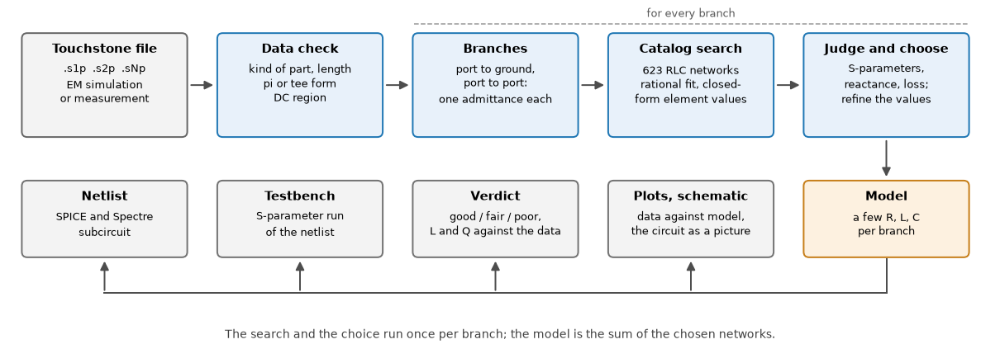
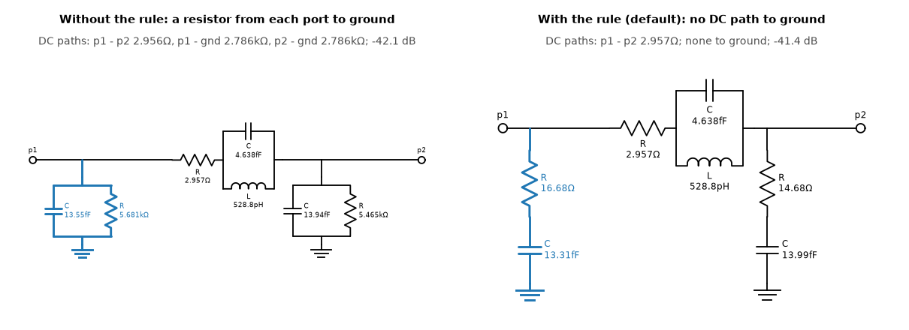
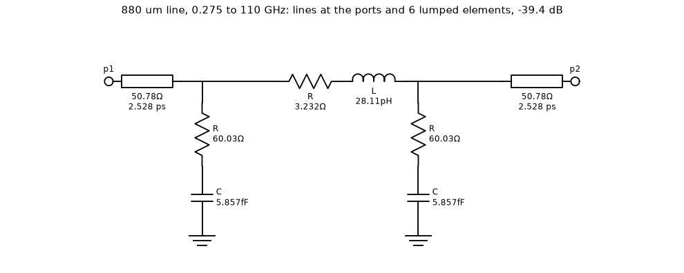

# FAQ: from EM simulation to a SPICE model

For RF designers who have S-parameters of a passive part from an EM simulation (a `.sNp`
file) and want to use that part in a circuit simulation. Commands and options are in the
[README](../README.md); this page answers the questions that come up on the way.

- [What do I get?](#what-do-i-get)
- [Why not use the .sNp file directly in the simulator?](#why-not-use-the-snp-file-directly-in-the-simulator)
- [How is this different from a vector fit (black box model)?](#how-is-this-different-from-a-vector-fit-black-box-model)
- [Which parts can be modelled?](#which-parts-can-be-modelled)
- [How do I run it?](#how-do-i-run-it)
- [How should I set up the EM simulation?](#how-should-i-set-up-the-em-simulation)
- [Which frequency band should I fit?](#which-frequency-band-should-i-fit)
- [How do I read the result?](#how-do-i-read-the-result)
- [Small, Standard or Most accurate?](#small-standard-or-most-accurate)
- [Why does the Q of my inductor not match everywhere?](#why-does-the-q-of-my-inductor-not-match-everywhere)
- [What happens at DC?](#what-happens-at-dc)
- [What is the resistor Rdc in my netlist?](#what-is-the-resistor-rdc-in-my-netlist)
- [Is the model passive and stable in transient?](#is-the-model-passive-and-stable-in-transient)
- [What are the T elements (lines at the ports)?](#what-are-the-t-elements-lines-at-the-ports)
- [How do I connect the model in my circuit?](#how-do-i-connect-the-model-in-my-circuit)
- [Which simulators can read the netlist?](#which-simulators-can-read-the-netlist)
- [How do I check the model in my simulator?](#how-do-i-check-the-model-in-my-simulator)
- [The tool says "limited", "poor" or "not suited". What now?](#the-tool-says-limited-poor-or-not-suited-what-now)
- [What about parts with more than two ports?](#what-about-parts-with-more-than-two-ports)
- [Does the model cover temperature, process corners or noise?](#does-the-model-cover-temperature-process-corners-or-noise)

## What do I get?

A subcircuit of resistors, inductors and capacitors that has the same S-parameters as the
part in the band you chose, within a stated error. Some models also contain coupled
inductors (a `K` element) or a short piece of ideal line at the ports (a `T` element).



```
.SUBCKT mim_170fF_model p1 p2
C_p1 p1 0 8.98727e-15
C_p2 p2 0 6.88033e-16
R_p1p2 p1 p1p2_n2 1.04016
L_p1p2 p1p2_n2 p1p2_n3 7.09555e-12
C_p1p2 p1p2_n3 p2 1.70939e-13
.ENDS mim_170fF_model
```

The pins are `p1` to `pN` in the port order of the file; ground is node 0.

## Why not use the .sNp file directly in the simulator?

S-parameters are a table at the frequencies of the EM simulation. An AC or S-parameter
analysis inside that range can use the table as it is. Other analyses need more than the
table holds:

- **DC and the operating point.** The table usually does not contain 0 Hz. The simulator
  has to guess the DC behaviour from the lowest points.
- **Transient.** The simulator needs the response at all frequencies, also above the last
  point, and turns the table into an impulse response or its own fit. Small errors of the
  data, or a guess outside the range, can give a response that is not passive, and then a
  transient run that rings or grows.
- **Harmonic balance and periodic analyses.** Harmonics often fall above the last point of
  the data.
- **Support.** Not every simulator reads Touchstone files in every analysis.

A model of R, L and C has none of these problems: it is defined at every frequency, DC
included, and every simulator handles it in every analysis.

## How is this different from a vector fit (black box model)?

A vector fit describes the S-parameters by poles and residues and writes them as
controlled sources. It follows almost any data, but the elements have no physical
meaning, the netlist is long, and passivity has to be enforced after the fit.

This tool looks for a small circuit of real elements instead: one catalog network of up
to five R, L, C for each branch between two ports and from each port to ground.

| | This tool | Vector fit |
|---|---|---|
| Elements | R, L, C with positive values | controlled sources, any sign |
| Size | a handful of elements | grows with the number of poles |
| Passive | by construction | must be enforced |
| DC behaviour | visible in the circuit | follows from the fit |
| Parts it can follow | parts that are a few lumped branches | almost any |

Use this tool where it says "good". For parts it cannot follow (see the next question), a
black box fit such as [snp2le](https://github.com/iic-jku/snp2le) is the right tool.

## Which parts can be modelled?

The model is a set of branches of a few elements each. A part fits if it is that, as seen
from its ports.

Fits well:

- inductors, also with a centre tap, and transformers (as coupled coils)
- MIM and MOM capacitors
- short interconnect, pads, vias
- lines, also long ones: the tool then adds a piece of ideal line at each port, see
  [What are the T elements](#what-are-the-t-elements-lines-at-the-ports)

Does not fit:

- **filters and couplers,** which have many resonances in the band
- **coupled lines and rings of lines,** where the coupling is spread along the length
- **structures with several ports on the same conductor,** such as the wiring of a
  transistor core: the branches between such ports are not simple networks

You do not have to judge this yourself. The data check runs before the fit, takes
milliseconds, and says "suited", "limited" or "not suited" with the reason.

## How do I run it?

In a window:

```
crcat-gui
```

Choose the file, press "Extract model", read the verdict, save or copy the netlist. The
window needs three choices only: the file, the fit band and the model quality.

In a terminal:

```
crcat-netlist my_inductor.s2p --fmax 60
```

This writes the netlist, a testbench, the S-parameters of the model, plots and a JSON
file with all values next to the input file. `crcat-netlist my_inductor.s2p --check-only`
prints the data check and stops.

## How should I set up the EM simulation?

- **Start low.** The lowest frequency should be far below the band you care about, a
  factor of 10 or more. The tool reads the low-frequency inductance and capacitance from
  there, and also whether a branch conducts at DC. Data that start high leave these open.
- **Starting very low does no harm.** A sweep from a few Hz has many points where the
  S-parameters do not change at all. The tool leaves these out of the fit by itself and
  says so ("left out: 47 points ..."), and uses them to see which paths conduct at DC.
- **Enough points.** At least 12 frequencies in the fit band are required; 50 to 100 show
  the shape of Q and of a resonance well.
- **Go high enough.** Simulate to the highest frequency the circuit will see, harmonics
  included, if the part should be right there.
- **One ground reference.** The model has one ground node. Ports that are defined against
  a common ground give branches that are simple networks. Ports with separate local
  references can still be read, but often give a model that is "not suited".
- **Short feeds or de-embedded ports.** Feed lines become part of the model. That is fine
  if they belong to the part; if not, de-embed them in the EM tool.

## Which frequency band should I fit?

The band in which the circuit uses the part, and not more. A wider band asks more of the
same few elements, so the fit inside the band you need gets worse.

Two cases where a narrower band helps most:

- **A resonance above the band of use.** An inductor is often simulated far above its
  self-resonance. If the circuit works below it, stop the fit below it.
- **A part that becomes long.** The data check reports the electrical length at the top
  of the band and names the frequency up to which a few lumped elements follow.

"Full range" in the window, or leaving out `--fmin` and `--fmax`, fits all data.

If the part is used at one frequency but should stay sensible over a wide band (for DC,
harmonics, stability), keep the wide band and set the target frequency instead of
narrowing the band.

## How do I read the result?

```
good: 1 to 100 GHz: 5 elements, S-parameters within -49.7 dB, C within 0.22 %, Q within 8.1 % (median)
```

- **Verdict.** "good": all error limits are kept. "fair": usable, but look at the
  warnings. "poor": do not use it as it is.
- **S-parameter error.** The RMS difference between the S-parameters of model and data,
  all ports and frequencies of the fit band. -40 dB is 1 % of full scale.
- **L (or C) and Q.** For 2-ports, the median difference of the series inductance or
  capacitance and of the quality factor. These are the figures an inductor or capacitor
  is judged by; the S-parameter error alone can hide them, since a good inductor is
  nearly a through in 50 ohm.
- **DC paths.** Which ports are connected at DC and with what resistance.

The plots show the same against frequency. For an inductor or capacitor the window opens
the plot of L (or C), R and Q.

For a part with one or two ports the window and the saved `_crcat_schematic.png` show the
whole model as one circuit, as it would be drawn by hand; the element names are those of
the netlist branch by branch.

## Small, Standard or Most accurate?

Three choices of how much error to accept for how few elements:

- **Small:** fewer elements, more error allowed. For first looks and large circuits.
- **Standard:** the fewest elements that keep the default limits.
- **Most accurate:** the lowest error, whatever the number of elements.

With a model at hand, switching between them is instant. The plot "Size against
accuracy" shows the error for every size; a click on a point uses that model. As one
example, for a 170 fF MIM capacitor fitted to 100 GHz the three choices gave 3, 5 and 11
elements.

## Why does the Q of my inductor not match everywhere?

The series resistance of an inductor rises with frequency (skin and proximity effect,
substrate loss). A branch of at most five elements can follow that rise only roughly. The
default choice often takes a constant series resistance that is right in the middle of
the band and too high at the low end.

What helps:

- **Say where the part is used.** With a "Target frequency" (`--ftarget`), the error
  limits are three times tighter around it, and the result shows L and Q of model and
  data there. As one example, a 40 pH inductor fitted to 150 GHz and used at 28 GHz had
  Q 14.4 in the model against 10.9 in the data; with the target frequency set, 10.7.
- "Most accurate" uses more elements, and the resistance then rises with frequency.
- A narrower band around the target frequency.
- Look at the R and Q plot, not only at the S-parameter error.

The loss error limit (default 30 %) is what makes the tool care about R at all; with a
high-Q part the S-parameters hardly change with R.

## What happens at DC?

The fit only sees high frequencies, so the DC behaviour has to be protected on purpose.
Two things matter for a designer.

**No leakage where the part has none.** A resistor across a capacitor and a resistor in
series with it look almost the same at RF, but only the first conducts at DC. The tool
reads from the low end of the data which branches are open at DC and gives those branches
only networks without a DC path. Substrate loss, for example, becomes a resistor in
series with the oxide capacitance, never a resistor from the port to ground. The result
states it:

```
DC paths: p1 - p2 2.93Ohm; none to ground
```

`--dc no-ground` is stricter: never a DC path from a port to ground, whatever the data
say. Use it when the data start too high to show the DC behaviour.



**The DC resistance of a through path is not guaranteed.** The series resistance of the
model is fitted in the RF band. In the inductor example above it is 2.9 ohm, where the
data show 1.8 ohm at the lowest frequency. If the bias current through the part matters,
compare the "DC paths" line with the known DC resistance.

## What is the resistor Rdc in my netlist?

```
* no DC path at these nodes: resistor to ground for the operating point (it carries no DC current)
Rdc_c c 0 1e+09
```

Some models have an internal node that only capacitors connect to, for example the
centre of a tee of three capacitive legs. A simulator cannot find the DC voltage of such
a node. ngspice then reports "singular matrix", and Xyce reports a node without a DC path
to ground.

The 1 Gohm resistor gives that node a DC voltage. It is no leakage path: nothing feeds
the node at DC, so no DC current flows through the resistor, and the ports stay
isolated. At RF it is far too large to matter.

Ports never get such a resistor. Spectre netlists get none by default, since Spectre adds
its own small conductance. `--float-resistor 0` leaves it out, or sets another value.

## Is the model passive and stable in transient?

With the default setting, yes. All elements are positive R, L and C (and coupled coils
with a coupling factor below 1), and such a circuit cannot deliver energy. It is passive
at every frequency, inside and outside the fit band, and stable in transient.

The option "R positive, L and C any sign" gives up this guarantee. Resistors stay
positive, so the model does not produce power at any single frequency, but a negative
inductor or capacitor can make a transient run unstable. Use it for AC and S-parameter
work, and check a transient run before relying on it.

## What are the T elements (lines at the ports)?

A few lumped elements cannot follow a part that is long against the wavelength. For such
a part the tool puts a piece of ideal line at each port and models only the short rest
between the lines with lumped elements:

```
T_p1 p1 0 p1_c 0 Z0=50.78 TD=2.52762e-12
```

This happens by itself, and only when the data check finds the part longer than 90
degrees at the top of the fit band. The result says so and names delay and impedance. If
the model with lines is not better than the one without, the one without is kept.



The line is lossless, so the loss of the part is in the lumped elements. The `T` element
is a standard SPICE element. If your flow does not accept it, `--delay off` gives a model
of R, L and C only; for a long part that model is then only right at lower frequencies,
and the data check names how far.

## How do I connect the model in my circuit?

```
.include "my_inductor_crcat.sp"
X1 in out my_inductor_model
```

- Pins are `p1`, `p2`, ... in the port order of the Touchstone file.
- Ground is the global node 0, as in the S-parameter data, where every port is measured
  against ground. A part used floating in the circuit still has its capacitances to this
  ground, which is the substrate or ground plane of the EM simulation.
- A differential part is used with its two pins; nothing has to be converted.

## Which simulators can read the netlist?

| Format | Option | Status |
|---|---|---|
| SPICE (ngspice, Xyce, HSPICE syntax) | `--format spice` (default) | simulated with ngspice 46 in the tests, including coupled coils, lines and the Rdc resistor |
| Spectre | `--format spectre` | written, not yet run in Spectre |

Only standard elements are used: R, L, C, `K` for coupled inductors, `T` for the ideal
line (`mutual_inductor` and `tline` in Spectre).

## How do I check the model in my simulator?

Next to each netlist the tool writes a testbench (`_crcat_tb.sp`, `_crcat_tb.scs`). It
includes the model, puts a port at each pin and runs an S-parameter analysis over the fit
band. Compare its result with the `_crcat.sNp` file, which holds the S-parameters the
model should have, or with the EM data.

## The tool says "limited", "poor" or "not suited". What now?

The message names the reason, and the window offers a button for each remedy. In the
order to try them:

1. **Fit a narrower band.** The suggested frequency is where the part is still short, or
   where the model follows the data.
2. **Most accurate.** More elements per branch.
3. **Tee form** (2-ports). Some parts, capacitors with series inductance for example, are
   a tee and not a pi.
4. **Negative L and C.** Keeps resistors positive; see the note on
   [transient](#is-the-model-passive-and-stable-in-transient).

"Not suited" means the branches of the data are not networks of positive elements at
all, usually because conductors are coupled along their length or several ports sit on
one conductor. No setting changes that. Use a black box fit for such a part.

## What about parts with more than two ports?

Any port count is read. An n-port has a branch from each port to ground and between each
pair of ports, so the work grows quickly: a 6-port has 21 branches.

What is covered for multi-ports:

- centre-tapped inductors and transformers, through coupled coils
- lines that meet in one point (a T-junction) and separate lines in one file, through a
  line at each port

What is not: coupled lines, couplers, and cores with several ports on the same conductor.
The tee form exists for 2-ports only.

## Does the model cover temperature, process corners or noise?

- **Temperature and corners.** No. The model reproduces the one EM simulation it was made
  from. Other temperatures or metal thicknesses need their own EM run and their own
  model.
- **Noise.** The resistors of the model produce thermal noise in a noise analysis, as the
  simulator does for any resistor. For a passive part that is the right noise, as far as
  the model's loss matches the part.
